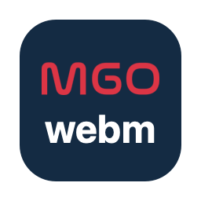

<p align="center">
  
</p>

<h1 align="center">WebM Converter</h1>

<p align="center">A small, native macOS app that batch-converts videos to WebM.</p>

## Features

- Add videos with the file picker or by dragging files and folders onto the window
- Supports MP4, MOV, M4V, MKV, AVI, WebM, WMV, FLV, MPEG, 3GP, TS/MTS and GIF input
- Adjustable quality (1–100, default 75)
- Scale the resolution down to 10%–100% of the original (50%, 60%, 70%, …)
- Choose any output folder; existing files are never overwritten (`video-1.webm`, `video-2.webm`, …)
- Shows the progress of each video and the resolution and file size before → after; conversion can be cancelled
- Respects rotation metadata, so iPhone videos don't come out rotated
- English and Turkish interface (follows the system language)

## Requirements

- macOS 13 Ventura or later
- [Homebrew](https://brew.sh)
- Xcode Command Line Tools (for building)

## Installation

1. Install the Xcode Command Line Tools, if you don't have them yet:

   ```bash
   xcode-select --install
   ```

2. Install FFmpeg, which the app uses for conversion:

   ```bash
   brew install ffmpeg
   ```

3. Clone the repository and build the app:

   ```bash
   git clone https://github.com/muratgokoglu/webm-converter.git
   cd webm-converter
   ./build.sh
   ```

   This creates `WebM Dönüştürücü.app` in the project folder.

4. Drag the app into your **Applications** folder and open it.

   The app is signed locally (ad-hoc), so since you built it yourself macOS opens it without warnings.

## Usage

1. Click **Add Videos…** or drag videos/folders onto the list.
2. Set the quality with the slider. 75 is a good balance for web use; lower values give smaller files.
3. Pick a resolution. 100% keeps the original resolution; 50% halves the width and height (the file size is set by the quality).
4. Click **Output Folder…** and choose where the WebM files should go.
5. Click **Convert to WebM**.

To remove a single file from the list, select it and press Delete.

## Changing the icon

The icon is generated from `logo.svg` by `make_icon.swift`. To change it, edit either file, delete `AppIcon.icns` and run `./build.sh` again.

## How it works

The app is a single SwiftUI file (`WebMConverter.swift`) compiled with `swiftc`, so there is no Xcode project. Each video is encoded with `ffmpeg` as VP9 video (constant quality, quality 75 ≈ CRF 27) and Opus audio. The video bitrate is capped at the source's bitrate (scaled by the pixel count), so an already well-compressed video doesn't come out larger than the original. Videos are converted one at a time, since FFmpeg already uses all CPU cores.

## License

[PolyForm Noncommercial 1.0.0](LICENSE). You may use, modify and share this software for any noncommercial purpose, such as personal use, study, hobby projects, or use by charities and educational institutions. Commercial use is not permitted; if you'd like to use it commercially, please get in touch.

## Author

[Murat Gökoğlu](https://muratgokoglu.com)
